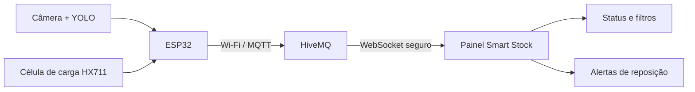

# Belart Smart Stock

Painel web para monitoramento inteligente do estoque da Belart. O sistema apresenta as leituras das três prateleiras, sinaliza níveis críticos e pode receber dados reais publicados pelo ESP32 via MQTT.

> Projeto acadêmico de IoT desenvolvido a partir dos requisitos do Belart Smart Stock.

## Visão geral

O painel foi criado para apoiar o administrador da loja no acompanhamento dos materiais usados na produção e sublimação. Ele combina a leitura de quantidade enviada pelos sensores com uma interface simples para tomada de decisão rápida.

### O que já está funcionando

- Visão geral das três prateleiras monitoradas.
- Identificação do produto e quantidade atual.
- Comparação automática com o limite mínimo.
- Badges de `Estoque OK` e `Repor estoque`.
- Filtro por todas as prateleiras, itens críticos ou estoque normal.
- Configuração dos limites mínimos por prateleira.
- Histórico dos últimos eventos recebidos.
- Indicadores de ESP32, câmera e broker MQTT.
- Simulação de leituras para demonstração sem hardware.
- Notificações locais do navegador quando um item entra em estado crítico.
- Conexão MQTT via WebSocket seguro com o broker HiveMQ.

## Tecnologias

| Tecnologia | Uso |
| --- | --- |
| React 19 | Componentes e gerenciamento de estado |
| Vite 8 | Servidor de desenvolvimento e build |
| MQTT.js | Comunicação MQTT via WebSocket |
| Lucide React | Ícones da interface |
| Oxlint | Verificação de código |

## Como executar

Requisitos: Node.js e npm instalados.

```bash
cd stock-app
npm install
npm run dev
```

Depois, abra `http://localhost:5173` no navegador.

### Outros comandos

```bash
# Verifica o código
npm run lint

# Gera a versão de produção
npm run build

# Executa uma prévia da versão compilada
npm run preview
```

## Modos de operação

### Modo demonstração

O sistema inicia com dados locais de exemplo, sem depender do ESP32. Use o botão **Simular leitura** para alterar aleatoriamente a quantidade de uma prateleira e observar a atualização do painel.

### Modo MQTT

Use **Conectar MQTT** para abrir uma conexão com o HiveMQ e assinar os três tópicos da aplicação:

```text
belart/estoque/prateleira1
belart/estoque/prateleira2
belart/estoque/prateleira3
```

O payload esperado é uma string com produto e quantidade separados por vírgula:

```text
Caneca,12
Garrafa,5
Azulejo,0
```

O painel interpreta o payload da seguinte forma:

| Parte | Exemplo | Resultado |
| --- | --- | --- |
| Produto | `Caneca` | Nome exibido no card |
| Quantidade | `12` | Número usado no cálculo do estoque |

A conexão configurada no app é:

```text
wss://broker.hivemq.com:8884/mqtt
```

O documento de requisitos também cita a porta `1883`. Como o navegador precisa de WebSocket seguro, esta implementação usa a porta `8884` indicada no requisito de conexão WSS.

## Regra de estoque crítico

Uma prateleira entra em estado crítico quando:

```text
quantidade <= limite mínimo
```

Quando ocorre a transição para esse estado, o sistema registra um evento e solicita uma notificação local ao navegador, caso a permissão tenha sido concedida.

## Estrutura do projeto

```text
stock-app/
├── public/                 # Arquivos públicos
├── src/
│   ├── App.jsx             # Dashboard, estado e integração MQTT
│   ├── App.css             # Estilos da interface responsiva
│   ├── index.css           # Reset e estilos globais
│   └── main.jsx            # Entrada do React
├── index.html
├── package.json
└── vite.config.js
```

## Arquitetura do fluxo



## Próximas evoluções

- Migrar o painel para React Native com Expo, caso o destino final seja um aplicativo mobile nativo.
- Persistir produtos, limites e histórico em uma API ou banco de dados.
- Adicionar autenticação para administradores e colaboradores.
- Trocar os ícones genéricos por imagens associadas a cada produto.
- Integrar o modelo YOLO e o firmware do ESP32 em ambiente físico.
- Registrar entradas, retiradas e confirmação de reposição.
- Adicionar testes automatizados para parsing MQTT e regras de estoque.

## Referências do projeto

Os requisitos funcionais e o contexto do sistema estão documentados nos arquivos:

- `Especificacao-de-Requisitos-Belart-Smart-Stock.md`
- `Trabalho-do-Grupo-Belart.md`
