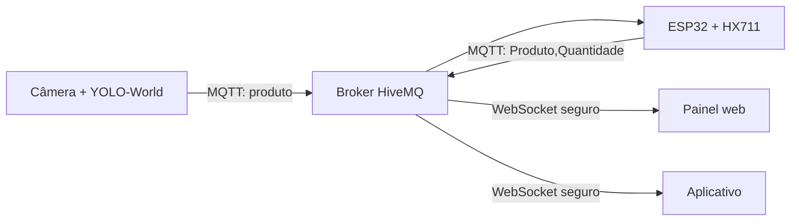

# Belart Smart Stock — Painel web

Painel web para monitoramento do estoque da Belart. Ele recebe, pelo broker MQTT, os mesmos dados que o aplicativo (`../belartbh`) recebe do ESP32 e mostra o produto e a quantidade de cada uma das três prateleiras.

> Projeto acadêmico de IoT desenvolvido a partir dos requisitos do Belart Smart Stock. O ESP32 e as balanças HX711 são simulados no Wokwi.

## Visão geral

O painel apoia o administrador da loja no acompanhamento do estoque de **canecas** e **garrafas**. As quantidades vêm do ESP32, que combina o produto identificado pela câmera com o peso de cada prateleira.

### O que o painel faz

- Conecta automaticamente ao broker ao abrir a página e reconecta sozinho se a conexão cair.
- Mostra as três prateleiras com produto, quantidade, limite mínimo e hora da última leitura.
- Compara a quantidade com o limite mínimo do produto: `Estoque OK` ou `Repor estoque`.
- Mostra `Aguardando dados` quando não há produto detectado, sem tratar isso como estoque zerado.
- Filtra por todas as prateleiras, críticas ou com estoque OK.
- Permite configurar o limite mínimo de cada produto.
- Registra as mudanças recebidas (não repete leituras iguais).
- Indica a conexão com o broker e se o ESP32 e a câmera estão enviando dados.
- Envia notificação do navegador quando uma prateleira entra em estado crítico (se permitido).

O painel não usa dados de exemplo: até a primeira mensagem do ESP32, as prateleiras aparecem como `Aguardando dados`.

## Tecnologias

| Tecnologia | Uso |
| --- | --- |
| React 19 | Componentes e gerenciamento de estado |
| Vite 8 | Servidor de desenvolvimento e build |
| MQTT.js | Comunicação MQTT via WebSocket |
| Lucide React | Ícones da interface |
| Oxlint | Verificação de código |

## Como executar

Requisitos: Node.js e npm instalados.

```bash
cd site
npm install
npm run dev
```

Depois, abra `http://localhost:5173` no navegador. Para ver dados, a simulação do ESP32 no Wokwi precisa estar rodando.

### Outros comandos

```bash
# Verifica o código
npm run lint

# Gera a versão de produção
npm run build

# Executa uma prévia da versão compilada
npm run preview
```

## Comunicação MQTT

Mesma configuração do aplicativo:

```text
wss://broker.hivemq.com:8884/mqtt
```

O navegador precisa de WebSocket seguro, por isso usa a porta `8884`. O Python e o ESP32 usam TCP na porta `1883`.

Tópicos assinados (refeitos a cada conexão):

```text
belart/estoque/prateleira1
belart/estoque/prateleira2
belart/estoque/prateleira3
```

O ESP32 publica produto e quantidade separados por vírgula:

```text
Caneca,29
Garrafa,3
Nenhum,0
Aguardando IA...,0
```

| Mensagem | Como aparece |
| --- | --- |
| `Caneca,29` / `Garrafa,3` | Produto e quantidade, com status pelo limite mínimo |
| `Nenhum,0` | `Sem produto`, status `Aguardando dados` |
| `Aguardando IA...,0` | O ESP32 ainda não recebeu nenhuma detecção da câmera; status `Aguardando dados` |

O botão **Reconectar MQTT** força uma nova conexão com o broker.

## Regra de estoque crítico

Para Caneca e Garrafa, uma prateleira entra em estado crítico quando:

```text
quantidade <= limite mínimo do produto
```

Limites padrão, iguais aos do aplicativo: Caneca 30, Garrafa 20. Podem ser alterados pelo ícone de configuração de qualquer card (valem enquanto a página estiver aberta).

Quando uma prateleira entra nesse estado, o painel registra um evento e envia uma notificação local do navegador, caso a permissão tenha sido concedida.

## Indicadores dos sensores

Os tópicos de estoque não trazem o estado dos dispositivos, então o painel deduz:

- **ESP32:** enviando dados se chegou alguma mensagem nos últimos 10 segundos.
- **Câmera:** detecções recebidas quando alguma prateleira deixa de mostrar `Aguardando IA...`, ou seja, o ESP32 já recebeu um produto do Python.

## Estrutura do projeto

```text
site/
├── public/
│   └── belart-logo.png     # Logotipo da Belart (cabeçalho e ícone da aba)
├── src/
│   ├── App.jsx             # Painel, estado e integração MQTT
│   ├── App.css             # Identidade visual roxa e amarela e layout responsivo
│   ├── index.css           # Fonte e estilos globais
│   └── main.jsx            # Entrada do React
├── index.html
├── package.json
└── vite.config.js
```

## Arquitetura do fluxo



## Próximas evoluções

- Persistir limites e histórico em uma API ou banco de dados.
- Adicionar autenticação para administradores e colaboradores.
- Trocar os ícones por imagens de cada produto.
- Registrar entradas, retiradas e confirmação de reposição.
- Adicionar testes automatizados para a leitura das mensagens MQTT e as regras de estoque.
